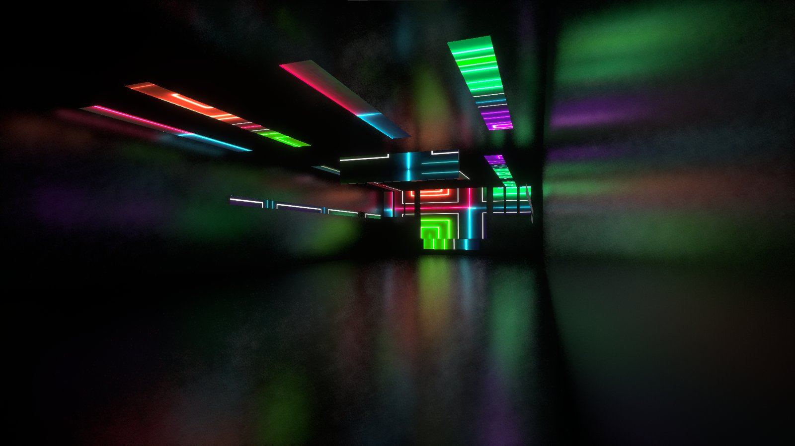
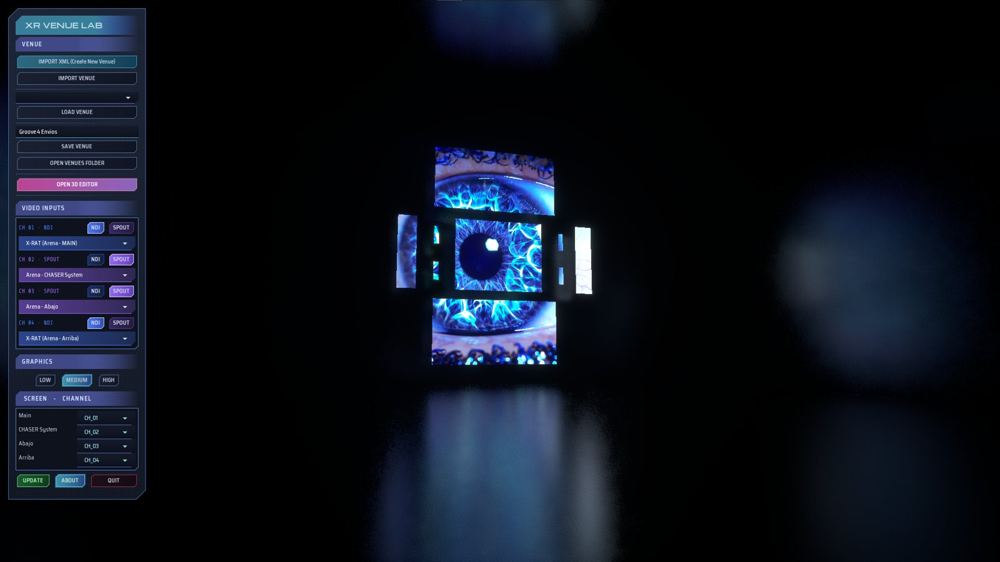
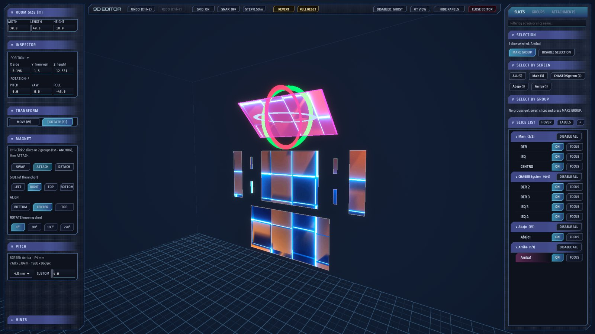

<h1 align="center">XR VENUE LAB</h1>

<b>See your show on the real venue before you get there.</b> 
Real-time LED screen previsualization for VJs, visual designers and show technicians.

<a href="https://github.com/X-Rat/XRVenueLab/releases/latest"><b>⬇ Download the free version</b></a> ·
<a href="docs/">Quick guides</a> ·
<a href="CHANGELOG.md">What's new</a> ·
<a href="https://www.youtube.com/@XRVenueLab">YouTube</a> ·
<a href="#español">Español</a>

---

## What it is

XR Venue Lab is a Windows application, built on Unreal Engine 5, that rebuilds the LED screens of a venue in 3D and plays your **live video** on them in real time.

You import the **Advanced Output XML from Resolume**, and every slice appears as a screen in a 3D room at its real size. Your content arrives live through **NDI®** or **Spout**, so you can walk around the venue as the technician would, check how each screen looks from the floor, and fix the mapping before the show — not during it.

## Who it is for

- **VJs and visual artists** who want to see how their content works on a specific stage.
- **Visual designers and production companies** who need to show a client what a show will look like.
- **Technicians** who prepare a venue mapping in advance and want to check sizes, positions and pitch.

## Main features

- **Resolume XML import**: screens, slices and output resolution are read straight from Resolume.
- **Live video** on the screens through NDI® or Spout, up to four input channels.
- **3D editor** inside the program: move and rotate screens with a gizmo, type exact positions, join screens edge to edge with the magnet, make groups, enable or disable slices, undo and redo.
- **Real size by LED pitch**, chosen per Screen, so each screen measures what the real one measures.
- **Technician view**: walk or fly through the venue at eye level (1.65 m).
- **Save and open venues** to reuse them or share them with colleagues.
- **Graphics quality** levels (LOW / MEDIUM / HIGH) for different computers.
- **Built-in update check**: the program tells you when there is a new version.

## Free version and full version

| | Free version | Full version |
|---|:---:|:---:|
| Resolume XML import and 3D editor | ✔ | ✔ |
| Live video through NDI® / Spout | 1 channel (CH 01) | 4 channels |
| Slices per venue | up to 10 | unlimited |
| Save venues | — | ✔ |
| Open venues shared by others | ✔ | ✔ |

The free version is enough for a single LED wall or a small stage. The full version will be available from our website soon.

## Download and install

1. Go to **[Releases](https://github.com/X-Rat/XRVenueLab/releases/latest)** and download the ZIP of the latest version.
2. Unzip it into any folder.
3. Run **XRVenueLab.exe**. There is no installer.

The quick guide (PDF, English and Spanish) is in the same folder as the program and also in **[docs](docs/)**.

**Requirements:** Windows 10 or 11 (64-bit) and a DirectX 12 graphics card. For live video you need a source that sends NDI® or Spout (for example Resolume, OBS or vMix).

## Updates

When a new version is published here, the **UPDATE** button in the program lights up and shows the list of improvements. To install it, close XR Venue Lab and download the new version. Your venues are not touched.

## Support

- Bugs and suggestions: open an **[Issue](https://github.com/X-Rat/XRVenueLab/issues)** here.
- E-mail: xrvenuelab@gmail.com
- YouTube: [@XRVenueLab](https://www.youtube.com/@XRVenueLab)

If you make something with XR Venue Lab, share it and tag us — it really helps.

## About this repository

This repository is used only to publish versions, documentation and update information. **It does not contain the source code** of the program.

© 2026 Facundo Piñeiro (X-Rat), Buenos Aires, Argentina. All rights reserved.
XR Venue Lab uses Unreal® Engine. Unreal® is a trademark or registered trademark of Epic Games, Inc. in the United States of America and elsewhere. NDI® is a registered trademark of Vizrt NDI AB. The licenses of all third-party components are included with each download (THIRD_PARTY_NOTICES.txt).

---

## Español

### Qué es

XR Venue Lab es un programa para Windows, hecho con Unreal Engine 5, que reconstruye en 3D las pantallas LED de un venue y les pone tu **video en vivo** en tiempo real.

Importás el **XML de Advanced Output de Resolume** y cada slice aparece como una pantalla en un recinto 3D, a su tamaño real. Tu contenido llega en vivo por **NDI®** o **Spout**, así podés recorrer el venue como lo haría el técnico, ver cómo se ve cada pantalla desde el piso y corregir el mapeo antes del show, no durante.

### Para quién es

- **VJs y artistas visuales** que quieren ver cómo funciona su contenido en un escenario concreto.
- **Diseñadores y productoras** que necesitan mostrarle a un cliente cómo va a verse un show.
- **Técnicos** que preparan el mapeo de un venue con anticipación y quieren chequear tamaños, posiciones y pitch.

### Funciones principales

- **Importa el XML de Resolume**: pantallas, slices y resolución de salida salen directo de Resolume.
- **Video en vivo** en las pantallas por NDI® o Spout, hasta cuatro canales de entrada.
- **Editor 3D** dentro del programa: mover y rotar pantallas con un gizmo, escribir posiciones exactas, unir pantallas borde con borde con el imán, armar grupos, habilitar o deshabilitar slices, deshacer y rehacer.
- **Tamaño real según el pitch del LED**, elegible por Screen.
- **Vista del técnico**: caminar o volar por el venue a la altura de los ojos (1,65 m).
- **Guardar y abrir venues** para reusarlos o compartirlos con colegas.
- **Calidad gráfica** LOW / MEDIUM / HIGH para distintas computadoras.
- **Aviso de actualizaciones** desde el mismo programa.

### Versión gratuita y versión completa

| | Gratuita | Completa |
|---|:---:|:---:|
| Importar XML de Resolume y editor 3D | ✔ | ✔ |
| Video en vivo por NDI® / Spout | 1 canal (CH 01) | 4 canales |
| Slices por venue | hasta 10 | sin límite |
| Guardar venues | — | ✔ |
| Abrir venues que te comparten | ✔ | ✔ |

La versión gratuita alcanza para una sola pantalla LED o un escenario chico. La versión completa va a estar disponible pronto en nuestra web.

### Descarga e instalación

1. Entrá a **[Releases](https://github.com/X-Rat/XRVenueLab/releases/latest)** y bajá el ZIP de la última versión.
2. Descomprimilo en cualquier carpeta.
3. Abrí **XRVenueLab.exe**. No necesita instalador.

La guía rápida (PDF en español e inglés) está en la misma carpeta del programa y también en **[docs](docs/)**.

**Requisitos:** Windows 10 u 11 (64 bits) y placa de video compatible con DirectX 12. Para el video en vivo necesitás una fuente que envíe NDI® o Spout (por ejemplo Resolume, OBS o vMix).

### Actualizaciones

Cuando se publica una versión nueva acá, el botón **UPDATE** del programa se enciende y muestra la lista de mejoras. Para instalarla, cerrá XR Venue Lab y bajá la versión nueva. Tus venues no se tocan.

### Soporte

- Errores y sugerencias: abrí un **[Issue](https://github.com/X-Rat/XRVenueLab/issues)** acá.
- Mail: xrvenuelab@gmail.com
- YouTube: [@XRVenueLab](https://www.youtube.com/@XRVenueLab)

Si hacés algo con XR Venue Lab, compartilo y etiquetanos: ayuda muchísimo.

### Sobre este repositorio

Este repositorio se usa solo para publicar versiones, documentación e información de actualizaciones. **No contiene el código fuente** del programa.
